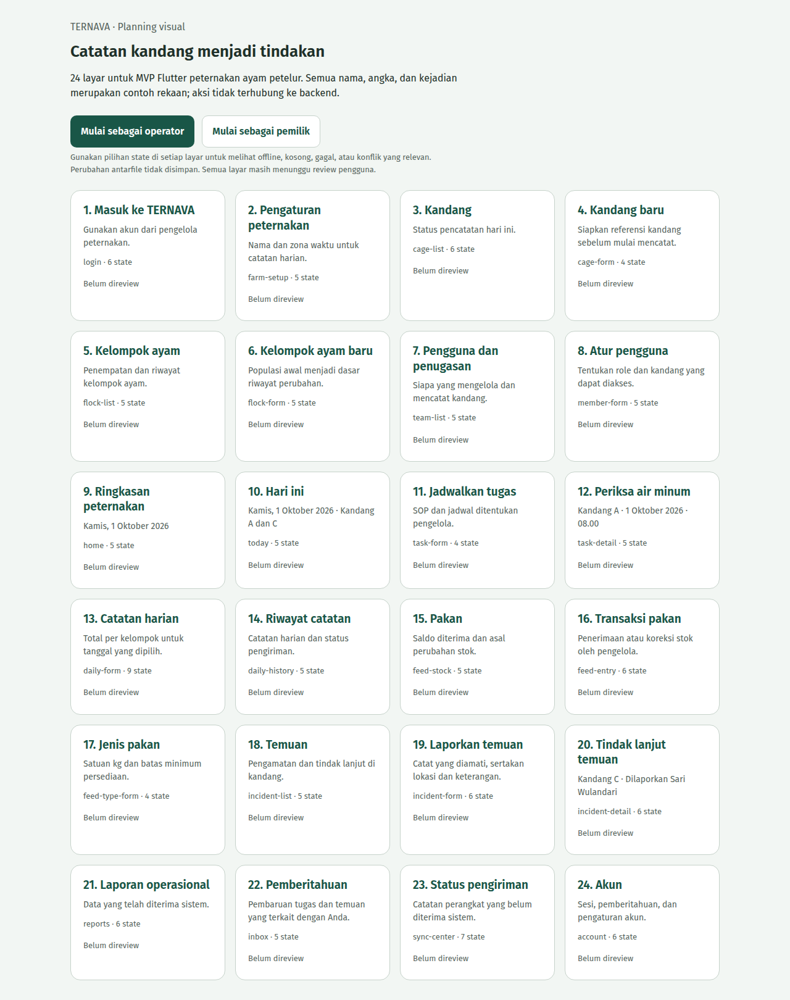
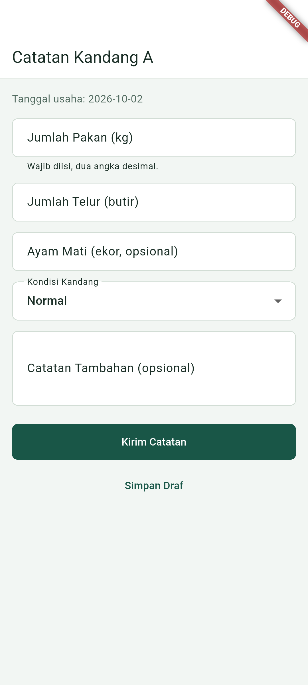
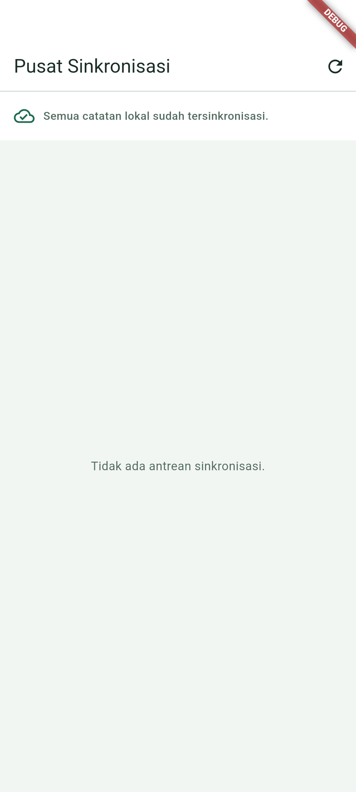

# 🐔 Ternava — Smart Poultry Farm Management & IoT Telemetry

> **Modern poultry farm operations platform tracking flock mortality, feed consumption, environmental conditions, and offline field data collection.**

---

## 📸 Visual Showcase & Field Operations

  

<em>Figure 1: Poultry Flock Overview tracking population count, feed conversion ratio (FCR), and mortality rate.</em>

 

  <table width="100%">
    <tr>
      <td width="50%" align="center">
        
         <strong>Figure 2: Daily Field Logging Form</strong> 
        <em>Mobile-friendly form for recording daily egg production, feed bags, water intake, and chicken weights.</em>
      </td>
      <td width="50%" align="center">
        
         <strong>Figure 3: Rural Coop Offline Sync Center</strong> 
        <em>Guarantees seamless offline entry in remote farm facilities with conflict resolution on cloud sync.</em>
      </td>
    </tr>
  </table>

